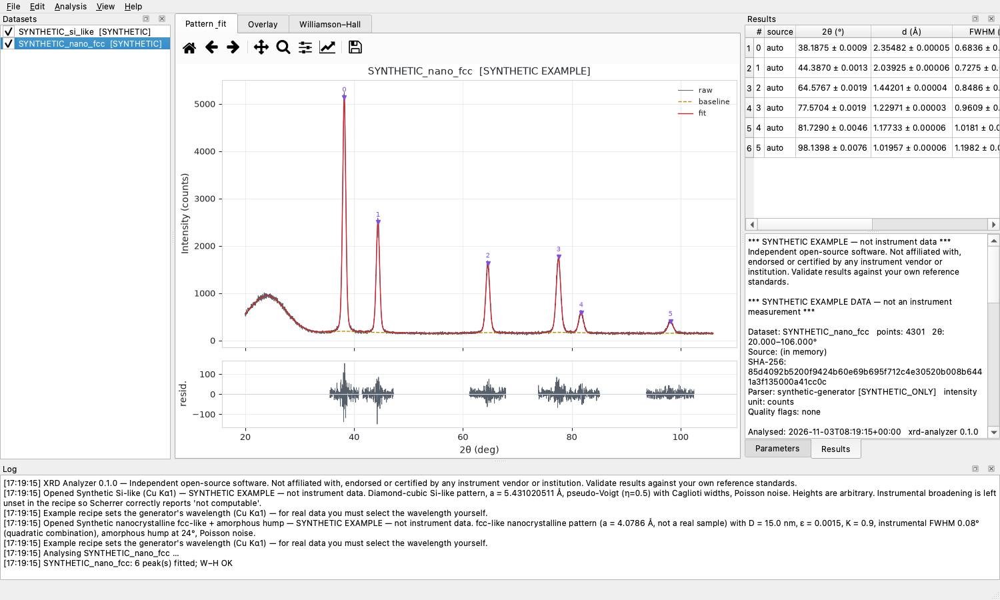
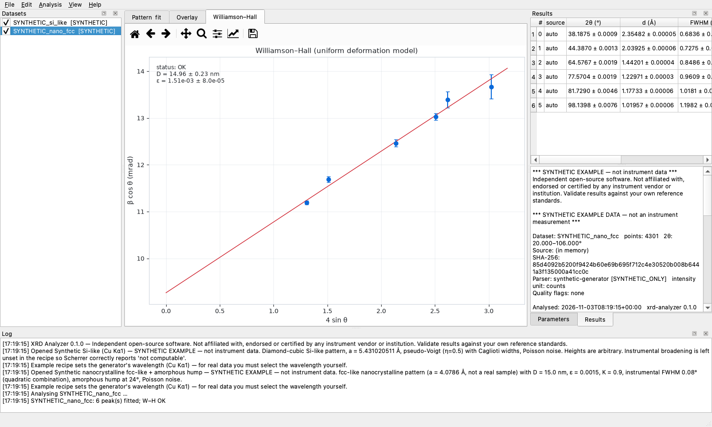
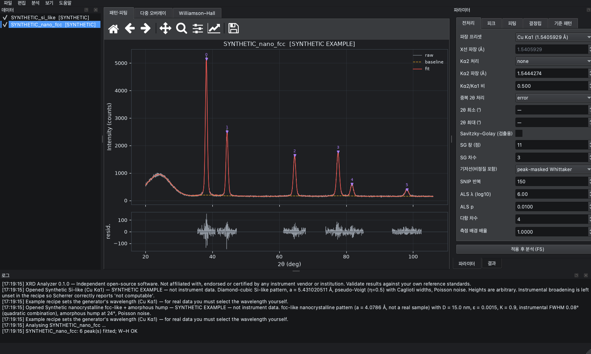

# XRD Analyzer

[](https://doi.org/10.5281/zenodo.23912324)

Desktop and command-line software for analysing **1D θ–2θ X-ray diffraction patterns**:
background and amorphous-baseline separation, Kα2 handling, peak detection and profile
fitting with uncertainties, Bragg d-spacings, guarded Scherrer and Williamson–Hall
crystallite-size analysis, phase-candidate comparison, and publication-ready reports.

[한국어 설명서 (README_KO.md)](README_KO.md) · [Building from source](docs/BUILDING.md) ·
[Scientific specification](docs/SPEC.md) · [Validation](docs/scientific_validation/VALIDATION.md)



> **Guiding rule:** the program never reports a number the data cannot support. Missing
> inputs (for example instrumental broadening for Scherrer) produce `NOT_CALCULABLE` with the
> reason, not a guessed value. Ambiguous input files (θ vs 2θ, unknown units) must be
> confirmed by you.

---

## Contents
1. [Download and install](#1-download-and-install)
2. [Quick start (GUI)](#2-quick-start-gui)
3. [Input data](#3-input-data)
4. [Analysis workflow in detail](#4-analysis-workflow-in-detail)
5. [Results and exported files](#5-results-and-exported-files)
6. [Command-line interface](#6-command-line-interface)
7. [Projects, recipes and reproducibility](#7-projects-recipes-and-reproducibility)
8. [Scientific basis](#8-scientific-basis)
9. [Validation](#9-validation)
10. [Limitations](#10-limitations)
11. [Troubleshooting](#11-troubleshooting)
12. [Development](#12-development)
13. [License and citation](#13-license-and-citation)

---

## 1. Download and install

Download the file for your system from the
[**Releases**](https://github.com/jongsu-king/xrd-analyzer/releases) page.

| System | File | Notes |
|---|---|---|
| Windows 10/11 (x64) | `XRD-Analyzer-<version>-windows-x64-setup.exe` | Installer: per-user by default (no admin rights), Start-menu entry, optional desktop icon, optional `PATH` entry for the command-line tool, uninstaller |
| Windows 10/11 (x64) | `XRD-Analyzer-<version>-windows-x64-portable.zip` | No installation: unzip and run `XRD-Analyzer.exe` |
| macOS 12+ (Apple Silicon) | `XRD-Analyzer-<version>-macos-arm64.dmg` | Open the DMG and drag **XRD Analyzer** to **Applications** |
| Ubuntu/Debian (x86_64) | `xrd-analyzer_<version>_amd64.deb` | `sudo apt install ./xrd-analyzer_<version>_amd64.deb`; adds a menu entry and the `xrd-analyzer` command |
| Other Linux (x86_64, glibc ≥ 2.35) | `XRD-Analyzer-<version>-linux-x86_64.tar.gz` | Extract and run `XRD-Analyzer/XRD-Analyzer` |

Each release also contains SHA-256 checksum files and `build-verification-reports.zip`
(the self-test reports produced by every build on its own operating system).

### First start on unsigned builds
The builds are not code-signed, so the operating system warns on first start:

- **Windows (SmartScreen):** "Windows protected your PC" → *More info* → *Run anyway*.
- **macOS (Gatekeeper):** "Apple could not verify …" → open *System Settings → Privacy &
  Security* and click *Open Anyway*, or Control-click the app → *Open*. Alternatively run
  `xattr -dr com.apple.quarantine "/Applications/XRD Analyzer.app"`.
- **Linux:** no warning. If the window does not appear, install the Qt runtime libraries
  listed in [Troubleshooting](#11-troubleshooting).

### Verify the download (optional)
```bash
shasum -a 256 XRD-Analyzer-0.1.1-macos-arm64.dmg     # macOS
sha256sum xrd-analyzer_0.1.1_amd64.deb               # Linux
certutil -hashfile XRD-Analyzer-0.1.1-windows-x64-setup.exe SHA256   # Windows
```
Compare the result with the matching `.sha256` file.

### Check the installation (optional)
Every build contains a self-test that analyses three synthetic patterns with known answers
and writes every export format:

| System | Command |
|---|---|
| Windows | `"%LOCALAPPDATA%\Programs\XRD Analyzer\xrd-analyzer-cli.exe" selftest` (per-user install path) |
| macOS | `"/Applications/XRD Analyzer.app/Contents/MacOS/xrd-analyzer-cli" selftest` |
| Linux (.deb) | `xrd-analyzer selftest` |

It prints a JSON report that ends with `"selftest": "PASS"`. Exit code 0 means every check passed.

### Install from source (any platform with Python 3.11+)
```bash
git clone https://github.com/jongsu-king/xrd-analyzer.git
cd xrd-analyzer
python3 -m venv .venv && source .venv/bin/activate     # Windows: .venv\Scripts\activate
pip install -e ".[gui]"
xrd-analyzer-gui
```

---

## 2. Quick start (GUI)

1. **Try an example:** *File → Open Example (synthetic)* → choose one of three synthetic
   patterns. They are generated by the program with known answers and are marked
   `[SYNTHETIC]` everywhere.
2. **Open your data:** *File → Open data…* (Ctrl+O) or drag files onto the window. If the
   column header does not state the axis quantity and unit unambiguously, a dialog shows a
   preview and asks you to confirm the **2θ column**, the **intensity column**, whether the
   axis is **2θ or θ**, the **unit** (degree/radian) and the **intensity unit** (counts, cps
   or a.u.).
3. **Set the wavelength:** in *Parameters → Preprocess*, choose *Cu Kα1 (1.5405929 Å)*, the
   weighted Cu Kα average, or *custom* and enter your calibrated value. Analysis refuses to
   run without a wavelength.
4. **Choose a baseline** (SNIP is a good start; use *peak-masked Whittaker* when there is a
   broad amorphous hump) and, if your tube is not monochromatic, a **Kα2 mode**
   (*fit Kα1/Kα2 doublet* is recommended).
5. Press **Apply & run (F5)**. Analysis runs in the background with a progress bar; *Esc*
   cancels and *Ctrl+P* pauses or resumes.
6. **Review:** the *Pattern & fit* tab shows raw data, baseline, fit, peak markers and
   residuals. The *Results* dock lists every peak with uncertainties and flags, and the summary
   gives warnings, the uncertainty model and provenance.
7. **Edit peaks:** *Edit → Add-peak mode* (A), then click the plot to add a peak. Select a row
   and press *Delete* to remove one. Every edit can be undone (Ctrl+Z) or redone
   (Ctrl+Shift+Z), and edits are stored in the recipe.
8. **Crystallite size (optional):** in *Parameters → Size*, enter the Scherrer shape factor K
   and the instrumental broadening (a constant FWHM or Caglioti U, V, W from a line-profile
   standard such as LaB₆ or Si). Without both, sizes are reported as `NOT_CALCULABLE`.
9. **Export:** *File → Export results…* (Ctrl+E) writes CSV, JSON, PNG, SVG, HTML and PDF.
   *File → Save project…* (Ctrl+S) stores everything needed to reproduce the analysis.



### Keyboard shortcuts
| Action | Shortcut | Action | Shortcut |
|---|---|---|---|
| Open data | Ctrl+O | Run analysis | F5 |
| Save project | Ctrl+S | Batch (checked datasets) | Shift+F5 |
| Export results | Ctrl+E | Cancel / pause | Esc / Ctrl+P |
| Undo / redo | Ctrl+Z / Ctrl+Shift+Z | Add-peak mode | A |
| Remove selected peak | Delete | Dark theme | Ctrl+T |
| Larger / smaller font | Ctrl+= / Ctrl+- | | |

The interface is available in **Korean and English** (*View* menu) and in light and dark themes.



---

## 3. Input data

### Supported formats
| Format | Status | Meaning |
|---|---|---|
| CSV, TXT, XY, DAT, TSV with a 2θ column and an intensity column | `SYNTHETIC_ONLY` | Implemented and tested with synthetic fixtures. Export your scan as text from the instrument software |
| Rigaku `.ras`/`.rasx`, Malvern Panalytical `.xrdml`, Bruker `.raw`/`.brml`, Philips `.udf` | `UNSUPPORTED` | Recognised and **refused with a clear message**. Vendor parsers are added only after validation against real files (see [docs/adapters.md](docs/adapters.md)) |

### Text-file rules
- **Delimiters:** tab, semicolon, comma or whitespace, detected per file. Decimal commas are
  detected and rejected with a message.
- **Encodings:** UTF-8 (with or without BOM), CP949 and Latin-1.
- **Comment and metadata lines** start with `#`, `;`, `!`, `//` or `%`. `key: value` and
  `key = value` are stored as metadata, and so are `key,value` lines before the header.
- **Recognised column headers** (examples): `2theta_deg`, `two_theta_deg`, `2θ (°)`,
  `2-Theta [deg]`, `2θ / rad`, `intensity_counts`, `Intensity (a.u.)`, `counts/s`, `cps`,
  `Intensity / counts`. Columns named like uncertainties (`error`, `esd`, `sigma`,
  `offset`, …) are never used automatically.
- A header that says only `theta` or `omega` is treated as **ambiguous**. You must confirm
  whether the values are θ or 2θ (θ is converted with 2θ = 2·θ and recorded as a quality flag).
- **Refused with a line number:** non-numeric rows inside the data, rows with a different
  number of columns, malformed rows after the header, NaN/Inf (unless you choose to drop them,
  which is recorded), 2θ outside (0°, 180°), fewer than 5 points, binary files.
- **Accepted with a quality flag:** descending or non-monotonic 2θ, duplicate 2θ values
  (you choose a policy: error, average or keep first), negative intensities, possible
  detector saturation, non-uniform steps, values that look like radians.
- The raw file is never modified, and its SHA-256 is recorded with every result.

Minimal example:
```text
# sample: my film, measured 2026-10-01
two_theta_deg,intensity_counts
20.00,523
20.02,519
...
```

---

## 4. Analysis workflow in detail

The processing order is fixed and recorded in every result:

| Step | Options | Guidance |
|---|---|---|
| 1. Axis ordering | duplicate policy `error` / `average` / `keep_first` | Averaging propagates the variance (σ² = λ/n for counts) |
| 2. Crop | 2θ min/max | Crop away regions outside your measured background |
| 3. Measured background | empty-holder or dark scan, scale factor | Interpolated onto the sample grid without extrapolation; the units must match; variances are added |
| 4. Kα2 | `none`, `strip` (Rachinger), `fit_doublet` | `fit_doublet` keeps the Poisson noise model and is preferred. `strip` correlates noise, so its uncertainties are marked approximate. With `none`, resolved Kα2 lines appear as extra peaks |
| 5. Smoothing | Savitzky–Golay window/order | Used **only for peak detection**; fits always use the unsmoothed data |
| 6. Baseline | SNIP, ALS, iterative polynomial, peak-masked Whittaker, none | SNIP is robust for flat or sloped backgrounds. *Peak-masked Whittaker* fits a smoother through non-peak regions and keeps broad **amorphous humps** in the baseline without absorbing peak tails |
| 7. Peak detection | threshold (× σ), minimum distance, minimum/maximum width, maximum number | σ is Poisson √counts for counts, otherwise a rolling noise estimate. Use a maximum width to stop a broad hump being taken as a peak |
| 8. Manual edits | add at 2θ / remove near 2θ | Stored in the recipe and replayed exactly |
| 9. Profile fitting | pseudo-Voigt or Voigt; local background none/constant/linear; window × FWHM | Overlapping peaks are fitted together. Auto-detected peaks that the fit does not confirm are rejected and the rest refitted |
| 10. Crystallography | wavelength, K, instrumental broadening, correction (quadratic/linear) | See [§8](#8-scientific-basis). Every value carries its formula, assumptions and status |
| 11. Reference comparison | computed cubic lattice (P, I, F, diamond) or your own licensed CSV; tolerance | Position-only **candidates** with a confidence level. Phase fractions are never reported |

**Batch analysis** (*Analysis → Batch*, Shift+F5) applies the current recipe to every checked
dataset; each dataset keeps its own measured background. A failing file does not stop
the batch. Batch statistics group reflections across files and report N, mean and standard
deviation of 2θ, d and FWHM.

---

## 5. Results and exported files

*Export results* writes into the folder you choose (`<name>` is the dataset name):

| File | Content |
|---|---|
| `<name>_peaks.csv` | One row per peak: 2θ ± σ (deg), d ± σ (Å), FWHM ± σ (deg 2θ), η, height ± σ, area ± σ, Scherrer size ± σ (nm) with status and reason, flags. Comment lines give the wavelength and uncertainty model |
| `<name>_processed.csv` | 2θ, raw intensity, after measured background, after Kα2 strip (if used), smoothed (if used), baseline, net |
| `<name>_result.json` | Everything: dataset summary with file and array SHA-256, full recipe, candidates, fit groups (χ², χ²_red, R², dof, condition number, convergence), derived quantities, Williamson–Hall, reference matches, warnings, notes, uncertainty model, provenance (software and library versions, algorithms, time stamp, measured-background identity) |
| `<name>_pattern.png` / `.svg` | Pattern, baseline, fit, peak markers, residuals (300 dpi PNG; SVG for editing) |
| `<name>_report.html` | Self-contained report (embedded figures, peak table, summary) |
| `<name>_report.pdf` | Multi-page report: summary and provenance, figure, peak table, Williamson–Hall plot. Korean text is supported when a CJK font is installed |

**Status values:** `OK`, `WARNING` (computed, but read the reason) and `NOT_CALCULABLE`
(not computed; the reason is given). **Peak flags** include `not_converged`,
`parameters_not_identifiable`, `center_at_bound`, `width_at_bound`,
`undersampled (FWHM < 3 steps)`, `low_significance (height < 3σ)` and
`window_truncated_at_scan_edge`.

---

## 6. Command-line interface

The command is `xrd-analyzer` (source install, Linux .deb) or `xrd-analyzer-cli` inside
the installed application folder.

```text
xrd-analyzer formats                       list formats and their status
xrd-analyzer examples --out DIR            write the synthetic examples (CSV + truth + recipe)
xrd-analyzer analyze FILE [options] --out DIR
xrd-analyzer batch FILE... [options] --out DIR
xrd-analyzer selftest [--out report.json]  verify this installation
xrd-analyzer gui-smoke [--offscreen]       open the GUI, analyse an example, close
xrd-analyzer gui                           start the GUI (also: no arguments)
```

| Option | Meaning |
|---|---|
| `--recipe FILE` | start from a saved recipe (other options override it) |
| `--wavelength VALUE` | Å, or `cu_ka1` / `cu_ka_avg` |
| `--wavelength2 VALUE`, `--ka2 none\|strip\|fit_doublet` | Kα2 handling |
| `--axis 2theta-deg\|2theta-rad\|theta-deg\|theta-rad` | confirm the x column quantity and unit |
| `--x-col N`, `--y-col N` | 0-based column indices |
| `--intensity-unit counts\|cps\|a.u.` | intensity unit |
| `--drop-nonfinite` | drop NaN/Inf rows (recorded as a quality flag) |
| `--duplicates error\|average\|keep_first` | duplicate-2θ policy |
| `--baseline none\|snip\|als\|poly\|masked` | baseline method |
| `--profile pseudo_voigt\|voigt` | peak profile |
| `--K VALUE`, `--inst-fwhm DEG` | Scherrer shape factor and constant instrumental FWHM (2θ) |
| `--add-peak DEG`, `--remove-peak DEG` | manual peak edits (repeatable) |
| `--reference-cubic a,centering[,name]` | computed reference, e.g. `5.431020511,diamond,Si` |
| `--reference-csv FILE` | reference CSV (`d_A` or `two_theta_deg` + `# wavelength_A:`) |
| `--out DIR`, `--no-pdf` | output folder; skip the PDF report |

Exit codes: `0` success · `1` self-test failed · `2` input error (format, or axis/column
confirmation needed) · `3` analysis error or partial batch failure.

Example:
```bash
xrd-analyzer analyze scan.xy --axis 2theta-deg --wavelength cu_ka1 \
    --ka2 fit_doublet --wavelength2 1.5444274 --baseline masked \
    --K 0.9 --inst-fwhm 0.05 --reference-cubic 5.431020511,diamond,Si --out results/
```

---

## 7. Projects, recipes and reproducibility
- **Recipe** (`*.json`, format `xrd-analyzer-recipe`): every parameter, including manual peak
  edits. Strictly validated: unknown keys, wrong types, non-integers and non-finite numbers
  are refused.
- **Project** (`*.xrdproj.json`, format `xrd-analyzer-project`): each
  dataset with its recipe. Raw files are referenced by path and verified by **SHA-256** when
  the project is opened; a changed or missing file is reported instead of being silently
  replaced. Measured backgrounds and in-memory data are embedded and verified by array hash.
- Results record the file hash, the normalised-array hash, the software and library
  versions, the algorithms and the measured-background identity.

---

## 8. Scientific basis

| Quantity | Formula | Conditions |
|---|---|---|
| Bragg spacing | d = nλ / (2 sin θ), θ = (2θ)/2, n = 1; σ_d = d·cot θ·σ_θ | wavelength uncertainty not included; no zero-shift correction |
| Scherrer size | D = Kλ / (β cos θ), β = sample FWHM in 2θ **in radians** | requires K and instrumental broadening. β_s² = β_m² − β_i² (Gaussian) or β_s = β_m − β_i (Lorentzian). Refused if β_m ≤ β_i. Warned when β_i = 0 (lower bound), when β_m < 1.2 β_i, and above 150 nm |
| Williamson–Hall | β_s cos θ = Kλ/D + 4ε sin θ | ≥ 3 converged, identifiable peaks spanning Δ(4 sin θ) ≥ 0.2; weighted regression. Intercept ≤ 0 → size not calculable; negative slope → warning; assumes one phase and isotropic broadening |
| pseudo-Voigt | H[ηL + (1−η)G], common FWHM w | area = H·w·[η·π/2 + (1−η)·√(π/(4 ln 2))] |
| Voigt | `scipy.special.voigt_profile` | FWHM after Olivero & Longbothum (≈ 0.02 %) |
| Fit uncertainty | cov = (JᵀJ)⁻¹ × max(1, χ²_red) (Poisson weights) or × χ²_red (unweighted) | derived quantities by the delta method |

Wavelength presets: Cu Kα1 = 1.5405929 Å and Kα2 = 1.5444274 Å (International Tables for
Crystallography Vol. C, Table 4.2.2.1). Always confirm the wavelength used by your
instrument. Full details are in [docs/SPEC.md](docs/SPEC.md).

---

## 9. Validation
All numerical validation uses **synthetic patterns with known answers** and analytic checks
(see [VALIDATION.md](docs/scientific_validation/VALIDATION.md)):

| Example | Result |
|---|---|
| Si-like (Cu Kα1) | 6/6 reflections; \|Δ2θ\| ≤ 0.001°, \|Δd\| ≤ 1×10⁻⁵ Å, FWHM within 4 %; Scherrer correctly `NOT_CALCULABLE` without instrumental broadening |
| Si-like with Kα2 (doublet fit) | 6/6 Kα1 positions within 0.001° |
| Nanocrystalline fcc-like (D = 15 nm, ε = 1.5×10⁻³) with an amorphous hump | Williamson–Hall D = 14.96 ± 0.23 nm, ε = (1.51 ± 0.08)×10⁻³; hump separated into the baseline (≈ 5 counts error) |

There are **294 automated tests**, and analysis-core coverage is 95 %. They include
malformed and ambiguous files, NaN/Inf, duplicates, non-convergence, identifiability,
variance propagation, provenance, the GUI (offscreen) and the command-line interface.
Packaged builds are verified on Windows, macOS and Linux by the release workflow:
frozen self-test, GUI smoke test, and install tests of the Windows installer and the .deb.

---

## 10. Limitations
- No real instrument files were available during development; generic text import is
  `SYNTHETIC_ONLY`, and vendor binary formats are unsupported.
- No rocking curves, reciprocal-space maps, XRR, 2D images or Rietveld refinement.
- Scherrer and Williamson–Hall use FWHM (not integral breadth). Instrumental-broadening and
  wavelength uncertainties are not propagated.
- After Kα2 stripping or interpolated background subtraction, neighbouring points are
  correlated. Uncertainties are then marked approximate (correlations ignored).
- Header preambles: numeric metadata placed after an axis-naming line and before a column
  header the program does not fully recognise is rejected as ambiguous. Move such lines
  above, or use recognised column names such as `2theta_deg,intensity_counts`.
- Builds: macOS on Apple Silicon only (no Intel build); Windows x64; Linux x86_64 with glibc
  ≥ 2.35. Builds are not code-signed.

---

## 11. Troubleshooting
| Problem | Solution |
|---|---|
| "axis quantity/unit not declared" | Confirm the columns in the dialog, or use `--axis 2theta-deg` (and `--x-col/--y-col`) on the command line |
| "wavelength is not set" | Choose a preset or enter your calibrated wavelength in *Preprocess* |
| "decimal comma detected" | Export with decimal points, or convert the file |
| "malformed data row … after the column header" | Fix or delete the reported line; move metadata above the header |
| Scherrer shows `NOT_CALCULABLE` | Enter K **and** the instrumental broadening measured on a line-profile standard |
| Extra peaks next to every reflection | Your data contain Kα2. Choose *fit Kα1/Kα2 doublet* |
| A broad hump is reported as a peak | Use the *peak-masked Whittaker* baseline and/or set a maximum peak width |
| Linux: window does not open (`xcb` plugin error) | `sudo apt install libxcb-cursor0 libxkbcommon-x11-0 libegl1 libgl1 libxcb-icccm4 libxcb-image0 libxcb-keysyms1 libxcb-randr0 libxcb-render-util0 libxcb-shape0 libxcb-xinerama0` |
| Korean text missing in PDF | Install a CJK font (e.g. Noto Sans CJK KR); the HTML report is unaffected |
| macOS/Windows refuses to start the app | See [First start on unsigned builds](#first-start-on-unsigned-builds) |

---

## 12. Development
```bash
pip install -e ".[dev]"
QT_QPA_PLATFORM=offscreen pytest            # 294 tests
ruff check src tests && mypy
python tools/generate_examples.py           # regenerate examples/synthetic
```
- Architecture: `io` (readers and validation) → `core` (preprocessing, peaks, fit,
  uncertainty, crystallography, reference, analysis pipeline) → `reports` (figures and
  exports) → `ui` (PySide6). The analysis core never imports Qt.
- Building installers: [docs/BUILDING.md](docs/BUILDING.md). Releases are built by
  `.github/workflows/release.yml` when a `v*` tag is pushed.
- Contributing: [CONTRIBUTING.md](CONTRIBUTING.md). Adding a vendor format:
  [docs/adapters.md](docs/adapters.md).

## 13. License and citation
MIT License — see [LICENSE](LICENSE). Independent open-source software, not affiliated with
any instrument vendor or institution.

**Cite this software** (archived on Zenodo):

> jongsu-king (2026). *XRD Analyzer: desktop and command-line analysis of 1D θ–2θ X-ray
> diffraction patterns* (v0.1.1). Zenodo. https://doi.org/10.5281/zenodo.23912325

- DOI of **all versions** (always resolves to the latest): [10.5281/zenodo.23912324](https://doi.org/10.5281/zenodo.23912324)
- DOI of **version 0.1.1**: [10.5281/zenodo.23912325](https://doi.org/10.5281/zenodo.23912325)
- Machine-readable metadata: [CITATION.cff](CITATION.cff) (GitHub shows a *Cite this repository* button).
