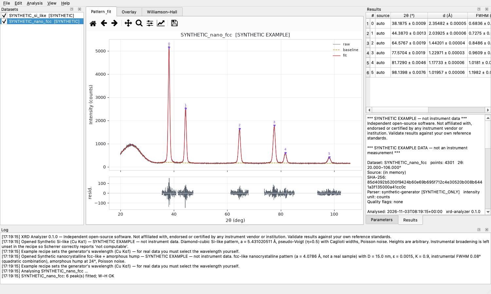
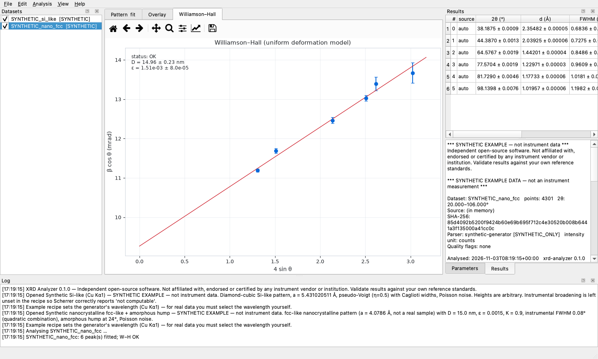
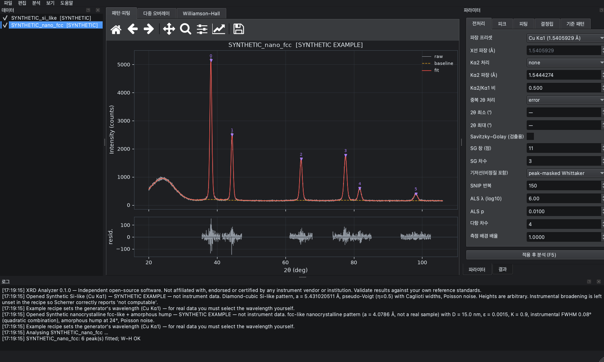

# XRD Analyzer (한국어 설명서)

[](https://doi.org/10.5281/zenodo.23912324)

**1D θ–2θ X선 회절(XRD) 패턴**을 분석하는 데스크톱·명령줄 프로그램입니다. 다음을 할 수 있습니다.
- 배경과 비정질 기저선 분리, Kα2 처리
- 불확도가 붙는 피크 검출·프로파일 피팅
- Bragg d 간격 계산
- Scherrer·Williamson–Hall 결정립 분석(입력 조건이 충족될 때만)
- 상(phase) 후보 비교, 출판용 보고서 생성

[English README](README.md) · [소스에서 빌드하기](docs/BUILDING.md) · [과학적 사양](docs/SPEC.md) ·
[검증 결과](docs/scientific_validation/VALIDATION.md)



> **원칙:** 데이터가 뒷받침하지 못하는 숫자는 출력하지 않습니다.
> - 입력이 부족하면(예: Scherrer 계산에 기기 broadening이 없으면) 값을 추정하지 않고
>   `NOT_CALCULABLE`과 그 이유를 표시합니다.
> - 파일이 애매하면(θ인지 2θ인지, 단위가 무엇인지) 추측하지 않고 사용자에게 확인을 받습니다.

---

## 목차
1. [다운로드와 설치](#1-다운로드와-설치)
2. [빠른 시작 (GUI)](#2-빠른-시작-gui)
3. [입력 데이터](#3-입력-데이터)
4. [분석 단계 상세](#4-분석-단계-상세)
5. [결과와 내보내기 파일](#5-결과와-내보내기-파일)
6. [명령줄(CLI) 사용법](#6-명령줄cli-사용법)
7. [프로젝트·레시피·재현성](#7-프로젝트레시피재현성)
8. [과학적 근거(수식)](#8-과학적-근거수식)
9. [검증](#9-검증)
10. [한계](#10-한계)
11. [문제 해결](#11-문제-해결)
12. [개발](#12-개발)
13. [라이선스·인용](#13-라이선스인용)

---

## 1. 다운로드와 설치

[**Releases**](https://github.com/jongsu-king/xrd-analyzer/releases) 페이지에서 운영체제에 맞는
파일을 받으세요.

| 운영체제 | 파일 | 설명 |
|---|---|---|
| Windows 10/11 (x64) | `XRD-Analyzer-<버전>-windows-x64-setup.exe` | 설치 프로그램. 기본은 현재 사용자 설치라 관리자 권한이 필요 없습니다. 시작 메뉴 등록, 바탕화면 아이콘(선택), 명령줄 도구 PATH 등록(선택), 제거 프로그램을 포함합니다 |
| Windows 10/11 (x64) | `XRD-Analyzer-<버전>-windows-x64-portable.zip` | 설치 없이 쓰는 휴대용 버전. 압축을 풀고 `XRD-Analyzer.exe`를 실행합니다 |
| macOS 12 이상 (Apple Silicon) | `XRD-Analyzer-<버전>-macos-arm64.dmg` | DMG를 열고 **XRD Analyzer**를 **Applications**로 끌어다 놓습니다 |
| Ubuntu/Debian (x86_64) | `xrd-analyzer_<버전>_amd64.deb` | `sudo apt install ./xrd-analyzer_<버전>_amd64.deb`로 설치합니다. 메뉴 항목과 `xrd-analyzer` 명령이 추가됩니다 |
| 기타 Linux (x86_64, glibc 2.35 이상) | `XRD-Analyzer-<버전>-linux-x86_64.tar.gz` | 압축을 풀고 `XRD-Analyzer/XRD-Analyzer`를 실행합니다 |

릴리스에는 다음도 함께 들어 있습니다.
- SHA-256 체크섬 파일
- `build-verification-reports.zip`: 각 운영체제에서 빌드할 때 생성된 자체 점검 보고서

### 서명되지 않은 빌드를 처음 실행할 때
코드 서명이 없어서 처음 실행하면 운영체제가 경고를 띄웁니다.

- **Windows (SmartScreen):** "Windows의 PC 보호" 창에서 *추가 정보* → *실행*을 누릅니다.
- **macOS (Gatekeeper):** "Apple에서 확인할 수 없습니다"가 뜨면 *시스템 설정 → 개인정보 보호 및 보안*에서
  *그래도 열기*를 누르거나, 앱을 Control-클릭한 뒤 *열기*를 고릅니다. 터미널에서 다음을 실행해도 됩니다.
  `xattr -dr com.apple.quarantine "/Applications/XRD Analyzer.app"`
- **Linux:** 경고는 없습니다. 창이 뜨지 않으면 [문제 해결](#11-문제-해결)에 있는 Qt 라이브러리를
  설치하세요.

### 다운로드 무결성 확인 (선택)
```bash
shasum -a 256 XRD-Analyzer-0.1.1-macos-arm64.dmg     # macOS
sha256sum xrd-analyzer_0.1.1_amd64.deb               # Linux
certutil -hashfile XRD-Analyzer-0.1.1-windows-x64-setup.exe SHA256   # Windows
```
출력값을 같은 이름의 `.sha256` 파일과 비교합니다.

### 설치 확인 (선택)
모든 빌드에는 자체 점검(self-test)이 들어 있습니다. 정답을 아는 합성 패턴 3종을 분석하고,
모든 형식으로 내보내기까지 해 봅니다.

| 운영체제 | 명령 |
|---|---|
| Windows | `"%LOCALAPPDATA%\Programs\XRD Analyzer\xrd-analyzer-cli.exe" selftest` (현재 사용자 설치 경로) |
| macOS | `"/Applications/XRD Analyzer.app/Contents/MacOS/xrd-analyzer-cli" selftest` |
| Linux (.deb) | `xrd-analyzer selftest` |

JSON 보고서가 출력되고 마지막 줄이 `"selftest": "PASS"`면 정상입니다. 종료 코드 0은 모든 점검을
통과했다는 뜻입니다.

### 소스에서 설치 (Python 3.11 이상)
```bash
git clone https://github.com/jongsu-king/xrd-analyzer.git
cd xrd-analyzer
python3 -m venv .venv && source .venv/bin/activate     # Windows: .venv\Scripts\activate
pip install -e ".[gui]"
xrd-analyzer-gui
```

---

## 2. 빠른 시작 (GUI)

1. **예제 열기:** *파일 → 예제 열기(합성 데이터)*에서 합성 패턴 3종 중 하나를 고릅니다. 프로그램이
   정답을 알고 생성한 데이터이고, 모든 화면에 `[SYNTHETIC]` 표시가 붙습니다.
2. **내 데이터 열기:** *파일 → 데이터 열기…*(Ctrl+O)를 누르거나 파일을 창으로 끌어다 놓습니다.
   열 이름만으로 축과 단위를 확정할 수 없으면, 미리보기와 함께 다음을 확인하는 창이 뜹니다.
   - **2θ 열**과 **강도 열**
   - 축이 **2θ인지 θ인지**
   - 축 **단위**(degree/radian)
   - **강도 단위**(counts, cps, a.u.)
3. **파장 설정:** *파라미터 → 전처리*에서 고릅니다. 파장이 없으면 분석이 실행되지 않습니다.
   - *Cu Kα1 (1.5405929 Å)*
   - Cu Kα 가중 평균
   - *사용자 지정*: 장비 보정값을 직접 입력
4. **기저선 선택:** 보통은 SNIP으로 시작합니다. 넓은 비정질 험프가 있으면 *피크 마스킹
   Whittaker*를 씁니다. 단색화되지 않은 X선이면 **Kα2 처리**도 고르세요(*Kα1/Kα2 이중 피크
   피팅*을 권장합니다).
5. **적용 후 분석 (F5):** 분석은 백그라운드에서 진행률과 함께 돕니다. *Esc*로 취소하고
   *Ctrl+P*로 일시정지·재개합니다.
6. **결과 검토:**
   - *패턴·피팅* 탭: 원본, 기저선, 피팅, 피크 표시, 잔차
   - *결과* 패널: 피크별 값, 불확도, 플래그
   - 요약: 경고, 불확도 모델, 출처(provenance)
7. **피크 편집:** *편집 → 피크 추가 모드*(A)를 켜고 그래프를 클릭하면 피크가 추가됩니다. 표에서
   행을 고르고 *Delete*를 누르면 제거됩니다. 모든 편집은 실행 취소(Ctrl+Z)와 다시 실행
   (Ctrl+Shift+Z)이 되고, 레시피에 저장됩니다.
8. **결정립 크기 (선택):** *파라미터 → 결정립*에 Scherrer 형상 인자 K와 기기 broadening을
   입력합니다. 기기 broadening은 LaB₆·Si 같은 표준시료로 측정한 일정 FWHM 또는 Caglioti U, V, W입니다.
   둘 다 없으면 크기는 `NOT_CALCULABLE`로 표시됩니다.
9. **내보내기와 저장:**
   - *파일 → 결과 내보내기…*(Ctrl+E): CSV, JSON, PNG, SVG, HTML, PDF
   - *파일 → 프로젝트 저장…*(Ctrl+S): 분석을 그대로 재현하는 데 필요한 정보 전부



### 단축키
| 기능 | 키 | 기능 | 키 |
|---|---|---|---|
| 데이터 열기 | Ctrl+O | 분석 실행 | F5 |
| 프로젝트 저장 | Ctrl+S | 배치 분석(체크된 데이터) | Shift+F5 |
| 결과 내보내기 | Ctrl+E | 취소 / 일시정지 | Esc / Ctrl+P |
| 실행 취소 / 다시 실행 | Ctrl+Z / Ctrl+Shift+Z | 피크 추가 모드 | A |
| 선택 피크 제거 | Delete | 다크 테마 | Ctrl+T |
| 글꼴 크게 / 작게 | Ctrl+= / Ctrl+- | | |

화면 언어는 **한국어·영어** 중에서 고를 수 있고(*보기* 메뉴), 라이트·다크 테마를 지원합니다.



---

## 3. 입력 데이터

### 지원 형식
| 형식 | 상태 | 의미 |
|---|---|---|
| 2θ 열과 강도 열이 있는 CSV, TXT, XY, DAT, TSV | `SYNTHETIC_ONLY` | 구현되어 있지만 합성 데이터로만 테스트했습니다. 장비 소프트웨어에서 텍스트로 내보내서 쓰세요 |
| Rigaku `.ras`/`.rasx`, Malvern Panalytical `.xrdml`, Bruker `.raw`/`.brml`, Philips `.udf` | `UNSUPPORTED` | 형식은 알아보지만 **명확한 메시지와 함께 거부**합니다. 벤더 형식 파서는 실제 파일로 검증한 뒤에만 추가합니다([docs/adapters.md](docs/adapters.md)) |

### 텍스트 파일 규칙
- **구분자:** 탭, 세미콜론, 쉼표, 공백. 파일마다 자동으로 감지합니다. 소수점 쉼표(예: `28,44`)는
  감지해서 메시지와 함께 거부합니다.
- **인코딩:** UTF-8(BOM 유무 무관), CP949, Latin-1.
- **주석·메타데이터:** `#`, `;`, `!`, `//`, `%`로 시작하는 줄은 주석입니다. 그중 `키: 값`,
  `키 = 값` 형태는 메타데이터로 저장하고, 헤더 앞의 `키,값` 줄도 메타데이터로 저장합니다.
- **인식하는 열 이름 예:** `2theta_deg`, `two_theta_deg`, `2θ (°)`, `2-Theta [deg]`, `2θ / rad`,
  `intensity_counts`, `Intensity (a.u.)`, `counts/s`, `cps`, `Intensity / counts`.
  `error`, `esd`, `sigma`, `offset`처럼 불확도를 뜻하는 이름의 열은 자동으로 고르지 않습니다.
- **θ 헤더:** `theta`나 `omega`만 적힌 헤더는 **애매한 것으로** 봅니다. 값이 θ인지 2θ인지
  사용자가 확인해야 합니다. θ를 고르면 2θ = 2·θ로 변환하고, 품질 플래그로 기록합니다.
- **줄 번호와 함께 거부하는 경우:**
  - 데이터 중간의 숫자가 아닌 행, 열 개수가 다른 행, 헤더 뒤의 손상된 행
  - NaN/Inf(사용자가 '제외'를 고르면 제외하고 그 사실을 기록)
  - 0°~180° 범위를 벗어난 2θ
  - 5점 미만인 데이터, 바이너리 파일
- **받아들이되 품질 플래그를 붙이는 경우:**
  - 내림차순이거나 단조롭지 않은 2θ
  - 중복된 2θ(처리 정책을 고릅니다: 오류 / 평균 / 첫 값 유지)
  - 음수 강도, 검출기 포화 가능성
  - 간격이 고르지 않은 스텝, 라디안처럼 보이는 값
- 원본 파일은 절대 수정하지 않고, 결과마다 원본의 SHA-256을 기록합니다.

최소 예:
```text
# sample: my film, measured 2026-10-01
two_theta_deg,intensity_counts
20.00,523
20.02,519
...
```

---

## 4. 분석 단계 상세

처리 순서는 고정되어 있고, 결과마다 기록됩니다.

| 단계 | 옵션 | 안내 |
|---|---|---|
| 1. 축 정렬 | 중복 정책 `error` / `average` / `keep_first` | 평균을 내면 분산도 전파합니다(counts는 σ² = λ/n) |
| 2. 범위 자르기 | 2θ 최소·최대 | 측정 배경이 덮지 못하는 구간은 잘라내세요 |
| 3. 측정 배경 | 빈 홀더·dark 스캔, 배율 | 시료의 2θ 격자로 보간합니다(범위 밖으로 외삽하지 않음). 단위가 같아야 하고, 분산은 더해집니다 |
| 4. Kα2 | `none`, `strip`(Rachinger), `fit_doublet` | `fit_doublet`을 권장합니다(Poisson 노이즈 모델 유지). `strip`은 노이즈를 상관시키므로 불확도가 근사값으로 표시됩니다. `none`이면 분리된 Kα2 선이 별도 피크로 나타납니다 |
| 5. 평활화 | Savitzky–Golay 창 크기·차수 | **피크 검출에만** 쓰고, 피팅은 항상 평활화하지 않은 데이터로 합니다 |
| 6. 기저선 | SNIP, ALS, 반복 다항식, 피크 마스킹 Whittaker, 없음 | SNIP은 평탄하거나 기울어진 배경에 강합니다. *피크 마스킹 Whittaker*는 피크가 아닌 구간만으로 기저선을 맞추므로, 넓은 **비정질 험프**는 기저선에 포함시키면서 피크 꼬리는 먹지 않습니다 |
| 7. 피크 검출 | 임계값(σ 배수), 최소 간격, 최소·최대 폭, 최대 개수 | counts 데이터는 Poisson √counts를 σ로 쓰고, 그 밖에는 국소 노이즈 추정을 씁니다. 넓은 험프가 피크로 잡히면 최대 폭을 지정하세요 |
| 8. 수동 편집 | 2θ 위치에 추가 / 근처 피크 제거 | 레시피에 저장되어 똑같이 재현됩니다 |
| 9. 프로파일 피팅 | pseudo-Voigt 또는 Voigt, 국소 배경(없음/상수/선형), 창 크기(× FWHM) | 겹친 피크는 함께 피팅합니다. 자동 검출 피크 중 피팅으로 확인되지 않은 것은 버리고 나머지를 다시 피팅합니다 |
| 10. 결정학 | 파장, K, 기기 broadening, 보정 방식(제곱/선형) | [§8](#8-과학적-근거수식) 참고. 모든 값에 수식, 가정, 상태가 붙습니다 |
| 11. 기준 패턴 비교 | 계산된 입방 격자(P, I, F, diamond) 또는 사용 권한이 있는 CSV, 허용 오차 | 피크 위치만으로 비교한 **후보**와 신뢰도를 보여줍니다. 상분율은 절대 계산하지 않습니다 |

**배치 분석**(*분석 → 배치*, Shift+F5)은 체크한 모든 데이터에 현재 레시피를 적용합니다.
- 각 데이터는 자기 측정 배경을 그대로 씁니다.
- 한 파일이 실패해도 배치는 계속됩니다.
- 배치 통계는 파일들에 걸쳐 같은 반사를 묶어, 2θ·d·FWHM의 N, 평균, 표준편차를 보여줍니다.

---

## 5. 결과와 내보내기 파일

*결과 내보내기*를 하면 고른 폴더에 다음 파일이 생깁니다(`<이름>`은 데이터 이름).

| 파일 | 내용 |
|---|---|
| `<이름>_peaks.csv` | 피크마다 한 행. 2θ ± σ(deg), d ± σ(Å), FWHM ± σ(2θ deg), η, 높이 ± σ, 면적 ± σ, Scherrer 크기 ± σ(nm)와 상태·이유, 플래그. 주석 줄에 파장과 불확도 모델이 적힙니다 |
| `<이름>_processed.csv` | 2θ, 원본 강도, 측정 배경 차감 후, Kα2 제거 후(사용 시), 평활화(사용 시), 기저선, 순강도 |
| `<이름>_result.json` | 전체 정보. 데이터 요약(파일·배열 SHA-256), 레시피 전체, 피크 후보, 피팅 그룹(χ², χ²_red, R², 자유도, 조건수, 수렴 여부), 계산값, Williamson–Hall, 기준 비교, 경고, 노트, 불확도 모델, 출처(소프트웨어·라이브러리 버전, 알고리즘, 시각, 측정 배경 정보) |
| `<이름>_pattern.png` / `.svg` | 패턴, 기저선, 피팅, 피크 표시, 잔차 그래프(PNG 300 dpi, 편집용 SVG) |
| `<이름>_report.html` | 그림이 포함된 단일 HTML 보고서(피크표, 요약) |
| `<이름>_report.pdf` | 여러 쪽짜리 보고서: 요약·출처, 그래프, 피크표, Williamson–Hall 그래프. CJK 글꼴이 있으면 한글도 표시됩니다 |

**상태 값:**
- `OK`: 정상
- `WARNING`: 계산은 했지만 이유를 꼭 읽어야 함
- `NOT_CALCULABLE`: 계산하지 않음(이유 표시)

**피크 플래그 예:** `not_converged`, `parameters_not_identifiable`, `center_at_bound`,
`width_at_bound`, `undersampled (FWHM < 3 steps)`, `low_significance (height < 3σ)`,
`window_truncated_at_scan_edge`.

---

## 6. 명령줄(CLI) 사용법

명령 이름은 `xrd-analyzer`(소스 설치, Linux .deb)이고, 설치 폴더 안에서는 `xrd-analyzer-cli`입니다.

```text
xrd-analyzer formats                       지원 형식과 상태
xrd-analyzer examples --out DIR            합성 예제 생성 (CSV + 정답 + 레시피)
xrd-analyzer analyze FILE [옵션] --out DIR
xrd-analyzer batch FILE... [옵션] --out DIR
xrd-analyzer selftest [--out report.json]  설치 상태 자체 점검
xrd-analyzer gui-smoke [--offscreen]       GUI를 열어 예제를 분석하고 닫기
xrd-analyzer gui                           GUI 실행 (인자 없이 실행해도 GUI)
```

| 옵션 | 의미 |
|---|---|
| `--recipe FILE` | 저장된 레시피에서 시작(다른 옵션이 우선) |
| `--wavelength 값` | Å 단위, 또는 `cu_ka1` / `cu_ka_avg` |
| `--wavelength2 값`, `--ka2 none\|strip\|fit_doublet` | Kα2 처리 |
| `--axis 2theta-deg\|2theta-rad\|theta-deg\|theta-rad` | x 열의 물리량·단위 확인 |
| `--x-col N`, `--y-col N` | 0부터 세는 열 번호 |
| `--intensity-unit counts\|cps\|a.u.` | 강도 단위 |
| `--drop-nonfinite` | NaN/Inf 행 제외(품질 플래그로 기록) |
| `--duplicates error\|average\|keep_first` | 중복 2θ 정책 |
| `--baseline none\|snip\|als\|poly\|masked` | 기저선 방법 |
| `--profile pseudo_voigt\|voigt` | 피크 프로파일 |
| `--K 값`, `--inst-fwhm DEG` | Scherrer K, 일정한 기기 FWHM(2θ) |
| `--add-peak DEG`, `--remove-peak DEG` | 수동 피크 편집(여러 번 지정 가능) |
| `--reference-cubic a,centering[,이름]` | 계산된 기준 패턴. 예: `5.431020511,diamond,Si` |
| `--reference-csv FILE` | 기준 CSV(`d_A` 열, 또는 `two_theta_deg` 열과 `# wavelength_A:` 줄) |
| `--out DIR`, `--no-pdf` | 출력 폴더, PDF 보고서 생략 |

종료 코드:
- `0`: 성공
- `1`: 자체 점검 실패
- `2`: 입력 오류(형식 문제, 또는 축·열 확인 필요)
- `3`: 분석 오류, 또는 배치 일부 실패

예:
```bash
xrd-analyzer analyze scan.xy --axis 2theta-deg --wavelength cu_ka1 \
    --ka2 fit_doublet --wavelength2 1.5444274 --baseline masked \
    --K 0.9 --inst-fwhm 0.05 --reference-cubic 5.431020511,diamond,Si --out results/
```

---

## 7. 프로젝트·레시피·재현성
- **레시피**(`*.json`, 형식 `xrd-analyzer-recipe`): 수동 피크 편집을 포함한 모든 파라미터를
  담습니다. 엄격하게 검증해서, 모르는 키·잘못된 타입·정수가 아닌 값·유한하지 않은 값은 거부합니다.
- **프로젝트**(`*.xrdproj.json`, 형식 `xrd-analyzer-project`): 데이터와 각 데이터의 레시피를 담습니다.
  - 원본 파일은 경로로 참조하고, 프로젝트를 열 때 **SHA-256**을 확인합니다. 파일이 바뀌었거나
    없으면 조용히 바꿔치기하지 않고 알려줍니다.
  - 측정 배경과 메모리에만 있는 데이터는 프로젝트 안에 넣고, 배열 해시로 검증합니다.
- **결과**에는 파일 해시, 정규화된 배열 해시, 소프트웨어·라이브러리 버전, 알고리즘, 측정 배경
  정보가 기록됩니다.

---

## 8. 과학적 근거(수식)

| 물리량 | 수식 | 조건 |
|---|---|---|
| Bragg 간격 | d = nλ / (2 sin θ), θ = (2θ)/2, n = 1. σ_d = d·cot θ·σ_θ | 파장 불확도와 영점 보정은 반영하지 않음 |
| Scherrer 크기 | D = Kλ / (β cos θ). β는 2θ 기준 시료 FWHM을 **라디안으로** 바꾼 값 | K와 기기 broadening이 모두 있어야 계산. β_s² = β_m² − β_i²(가우시안) 또는 β_s = β_m − β_i(로렌츠). β_m ≤ β_i면 거부. β_i = 0(하한값일 뿐), β_m < 1.2 β_i, 150 nm 초과는 경고 |
| Williamson–Hall | β_s cos θ = Kλ/D + 4ε sin θ | 수렴하고 식별 가능한 피크가 3개 이상이고 Δ(4 sin θ) ≥ 0.2일 때만 가중 회귀. 절편 ≤ 0이면 크기 계산 불가, 기울기가 음수면 경고. 단일상과 등방성 broadening을 가정 |
| pseudo-Voigt | H[ηL + (1−η)G], 공통 FWHM w | 면적 = H·w·[η·π/2 + (1−η)·√(π/(4 ln 2))] |
| Voigt | `scipy.special.voigt_profile` | FWHM은 Olivero & Longbothum 근사(오차 약 0.02 %) |
| 피팅 불확도 | cov = (JᵀJ)⁻¹ × max(1, χ²_red)(Poisson 가중) 또는 × χ²_red(가중 없음) | 계산값의 불확도는 델타 방법으로 전파 |

파장 프리셋: Cu Kα1 = 1.5405929 Å, Kα2 = 1.5444274 Å(International Tables for Crystallography
Vol. C, Table 4.2.2.1). 장비에서 실제로 쓰는 파장과 맞는지 꼭 확인하세요. 자세한 내용은
[docs/SPEC.md](docs/SPEC.md)에 있습니다.

---

## 9. 검증
수치 검증은 모두 **정답을 아는 합성 패턴**과 해석적 계산으로 했습니다
([VALIDATION.md](docs/scientific_validation/VALIDATION.md)).

| 예제 | 결과 |
|---|---|
| Si 유사 패턴 (Cu Kα1) | 반사 6/6 검출. \|Δ2θ\| ≤ 0.001°, \|Δd\| ≤ 1×10⁻⁵ Å, FWHM 오차 4% 이내. 기기 broadening이 없으므로 Scherrer는 올바르게 `NOT_CALCULABLE` |
| Si 유사 패턴 + Kα2 (이중 피크 피팅) | Kα1 위치 6/6, 오차 0.001° 이내 |
| 나노결정 fcc 유사 패턴(D = 15 nm, ε = 1.5×10⁻³) + 비정질 험프 | Williamson–Hall D = 14.96 ± 0.23 nm, ε = (1.51 ± 0.08)×10⁻³. 험프는 기저선으로 분리(오차 약 5 counts) |

- 자동 테스트는 **294개**이고, 분석 코어 커버리지는 95%입니다.
- 테스트 범위: 손상되거나 애매한 파일, NaN/Inf, 중복값, 피팅 미수렴, 식별 불가, 분산 전파,
  출처 기록, GUI(화면 없이 실행), CLI.
- 설치본 검증: 릴리스 워크플로가 Windows, macOS, Linux에서 각각 실행합니다.
  - 빌드된 앱의 자체 점검과 GUI 스모크 테스트
  - Windows 설치 프로그램과 .deb의 실제 설치 테스트

---

## 10. 한계
- 개발 중에 실제 장비 파일을 확보하지 못했습니다. 범용 텍스트 가져오기는 `SYNTHETIC_ONLY`이고,
  벤더 바이너리 형식은 지원하지 않습니다.
- rocking curve, 역격자 공간 맵(RSM), XRR, 2D 이미지, Rietveld 정련은 지원하지 않습니다.
- Scherrer와 Williamson–Hall은 FWHM 기반입니다(적분폭이 아님). 기기 broadening과 파장의 불확도는
  전파하지 않습니다.
- Kα2 제거나 보간된 배경을 차감하면 이웃 점끼리 상관됩니다. 이때 불확도는 근사값으로
  표시됩니다(상관 무시).
- 헤더 앞부분 배치: 축 이름이 들어간 줄 뒤, 그리고 프로그램이 완전히 인식하지 못하는 열 헤더 앞에
  숫자 메타데이터가 있으면 애매한 것으로 보고 거부합니다. 그런 줄을 위로 옮기거나, 인식되는 열
  이름(예: `2theta_deg,intensity_counts`)을 쓰세요.
- 빌드 범위:
  - macOS는 Apple Silicon 전용입니다(Intel 빌드 없음).
  - Windows는 x64, Linux는 x86_64(glibc 2.35 이상)입니다.
  - 코드 서명이 되어 있지 않습니다.

---

## 11. 문제 해결
| 증상 | 해결 |
|---|---|
| "axis quantity/unit not declared" | 창에서 열을 확인하세요. 명령줄에서는 `--axis 2theta-deg`(필요하면 `--x-col`/`--y-col`)를 씁니다 |
| "wavelength is not set" | *전처리* 탭에서 프리셋을 고르거나 보정된 파장을 입력하세요 |
| "decimal comma detected" | 소수점을 점(.)으로 내보내거나 파일을 변환하세요 |
| "malformed data row … after the column header" | 알려준 줄을 고치거나 지우고, 메타데이터는 헤더 위로 옮기세요 |
| Scherrer가 `NOT_CALCULABLE` | K와, 표준시료로 측정한 기기 broadening을 **둘 다** 입력하세요 |
| 모든 반사 옆에 피크가 하나씩 더 있음 | 데이터에 Kα2가 들어 있습니다. *Kα1/Kα2 이중 피크 피팅*을 고르세요 |
| 넓은 험프가 피크로 잡힘 | *피크 마스킹 Whittaker* 기저선을 쓰거나 최대 피크 폭을 지정하세요 |
| Linux에서 창이 안 뜸(`xcb` 플러그인 오류) | `sudo apt install libxcb-cursor0 libxkbcommon-x11-0 libegl1 libgl1 libxcb-icccm4 libxcb-image0 libxcb-keysyms1 libxcb-randr0 libxcb-render-util0 libxcb-shape0 libxcb-xinerama0` |
| PDF에 한글이 안 나옴 | CJK 글꼴(예: Noto Sans CJK KR)을 설치하세요. HTML 보고서는 영향이 없습니다 |
| macOS/Windows에서 앱이 실행되지 않음 | [서명되지 않은 빌드를 처음 실행할 때](#서명되지-않은-빌드를-처음-실행할-때)를 참고하세요 |

---

## 12. 개발
```bash
pip install -e ".[dev]"
QT_QPA_PLATFORM=offscreen pytest            # 294개 테스트
ruff check src tests && mypy
python tools/generate_examples.py           # examples/synthetic 다시 생성
```
- **구조:** `io`(읽기·검증) → `core`(전처리, 피크, 피팅, 불확도, 결정학, 기준 비교, 분석
  파이프라인) → `reports`(그래프·내보내기) → `ui`(PySide6). 분석 코어는 Qt를 전혀 import하지
  않습니다.
- **설치 프로그램 빌드:** [docs/BUILDING.md](docs/BUILDING.md). `v*` 태그를 push하면
  `.github/workflows/release.yml`이 릴리스를 만듭니다.
- **기여:** [CONTRIBUTING.md](CONTRIBUTING.md). 벤더 형식 추가: [docs/adapters.md](docs/adapters.md).

## 13. 라이선스·인용
MIT 라이선스입니다([LICENSE](LICENSE)). 어떤 장비 제조사나 기관과도 관련 없는 독립 오픈소스 소프트웨어입니다.

**인용 방법**(Zenodo에 보관됨):

> jongsu-king (2026). *XRD Analyzer: desktop and command-line analysis of 1D θ–2θ X-ray
> diffraction patterns* (v0.1.1). Zenodo. https://doi.org/10.5281/zenodo.23912325

- **모든 버전**을 가리키는 DOI(항상 최신 버전으로 연결): [10.5281/zenodo.23912324](https://doi.org/10.5281/zenodo.23912324)
- **0.1.1 버전**의 DOI: [10.5281/zenodo.23912325](https://doi.org/10.5281/zenodo.23912325)
- 기계가 읽는 인용 정보: [CITATION.cff](CITATION.cff)(GitHub 저장소의 *Cite this repository* 버튼)
